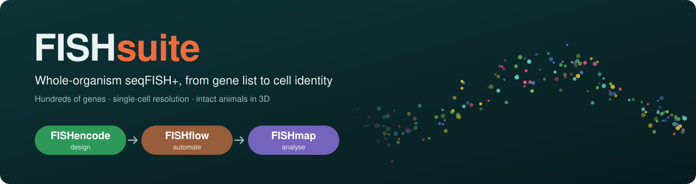
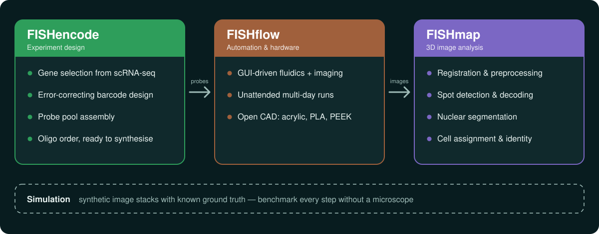
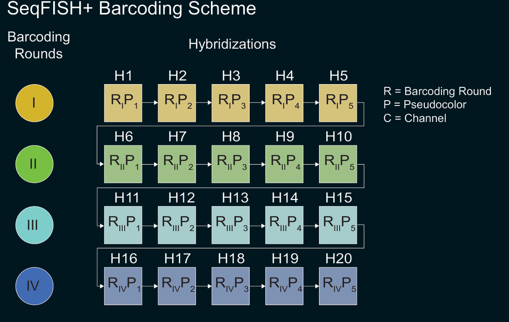
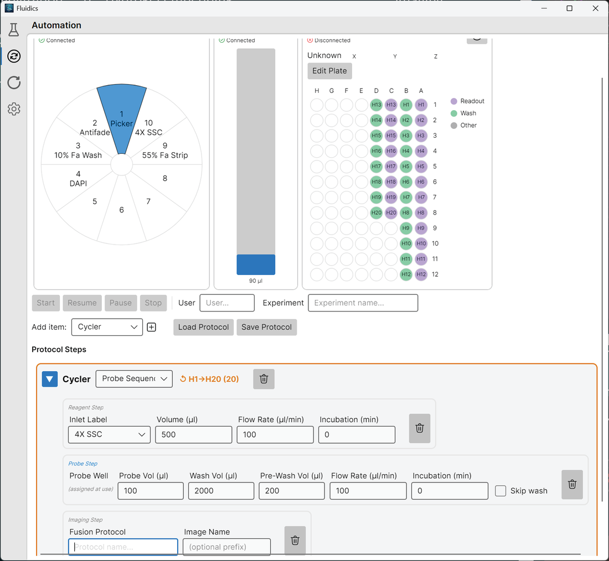
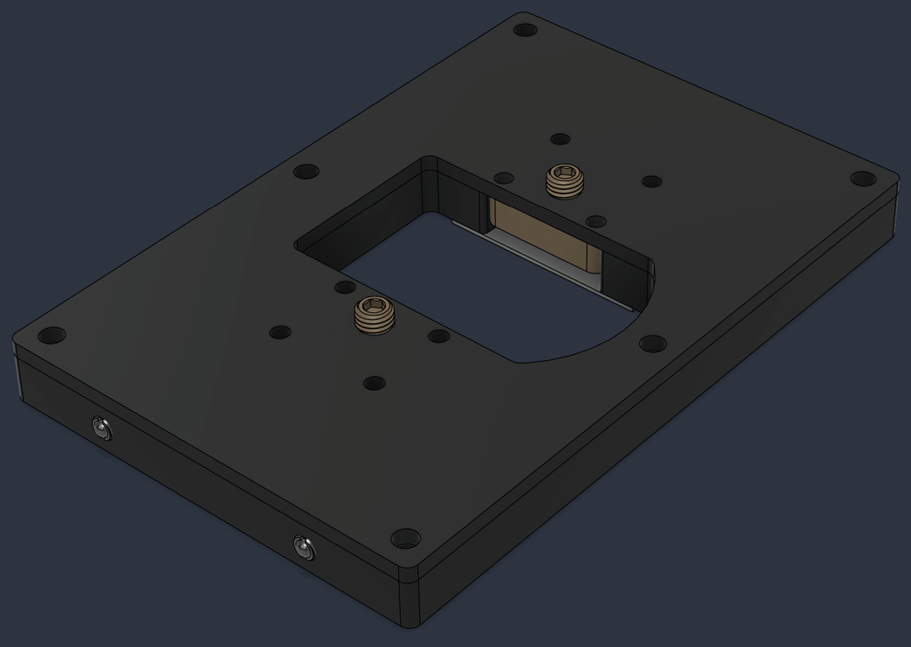
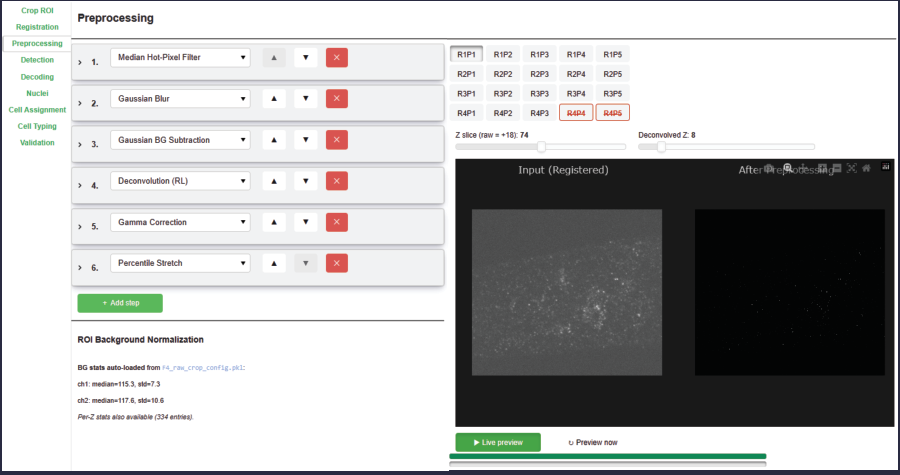
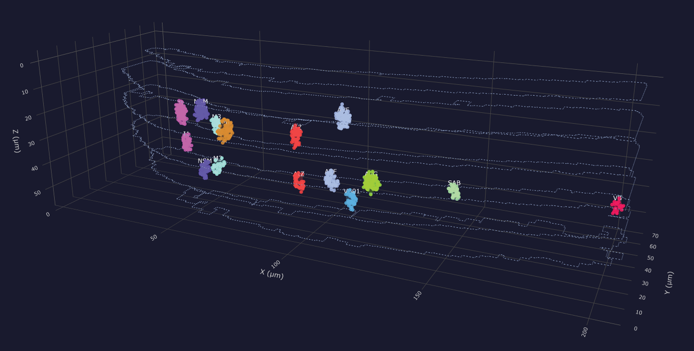
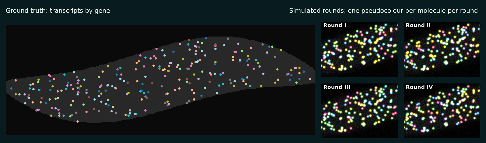

  

  <b>Open-source tools to design, run and analyse seqFISH+ experiments in whole, intact animals.</b> 
  Caltech, Biology and Biological Engineering

  
  
  

---

Single-cell RNA-seq in small organisms means dissociating and pooling many animals, and the spatial
information is lost. Fluorescent reporters keep it, but only for a few genes. **FISHsuite** is a seqFISH+
platform that profiles **up to 600 genes at single-cell resolution in a single intact animal**, imaged in 3D.
We developed it in *C. elegans*, which is transparent and has a fully mapped nervous system. It should
carry over to other samples under ~100 µm thick, such as thick brain slices.

> 🚧 **This is a placeholder.** All code, CAD files and protocols will be released here.
> Watch or star the repo to get notified.

  

## 🧬 FISHencode: experiment design

Choose an imaging panel from single-cell RNA-seq, design error-correcting combinatorial barcodes, and
assemble the probe pool into an oligo order ready for synthesis.

## ⚙️ FISHflow: automation and hardware

A GUI that runs the fluidics and the microscope for unattended, multi-day hybridisation and imaging.
It comes with open CAD files for the physical setup, which you can laser-cut in acrylic, 3D-print in PLA
or machine in PEEK.

<table>
  <tr>
    <td width="50%"></td>
    <td width="50%"></td>
  </tr>
  <tr>
    <td align="center">Protocol builder: reagents, probe plate, imaging</td>
    <td align="center">A laser-cuttable microfluidic device</td>
  </tr>
</table>

## 🔬 FISHmap: 3D image analysis

A GUI-driven pipeline with interactive previews at every step: registration, preprocessing, spot detection,
barcode decoding, nuclear segmentation, and assignment of transcripts to identified cells.

<table>
  <tr>
    <td width="45%"></td>
    <td width="55%"></td>
  </tr>
  <tr>
    <td align="center">Step-by-step dashboard with live previews</td>
    <td align="center">Decoded transcripts assigned to identified neurons</td>
  </tr>
</table>

## 🧪 Simulation

Synthetic image stacks with known ground truth, so you can benchmark detection and decoding without
a microscope.

## Applications

- **The "undead" nervous system.** Characterising surviving neuron-like cells in *ced-3* caspase mutants.
- **Novel model organisms.** Mapping the nervous system of the entomopathogenic nematode
  *Steinernema hermaphroditum*.

---

Sternberg Lab · California Institute of Technology

